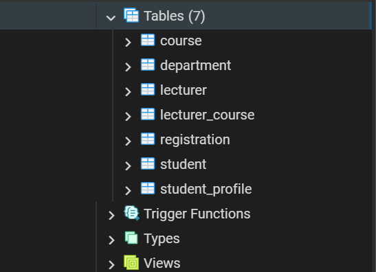
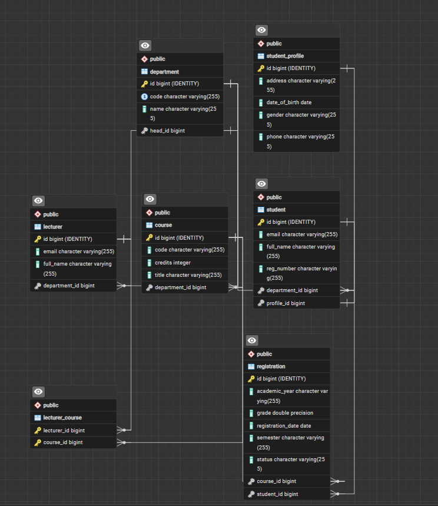
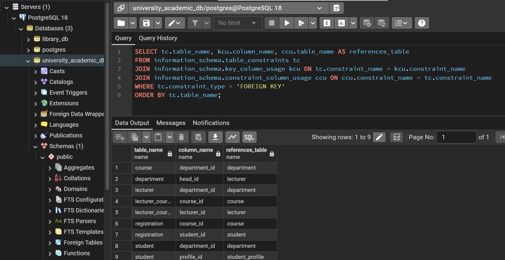
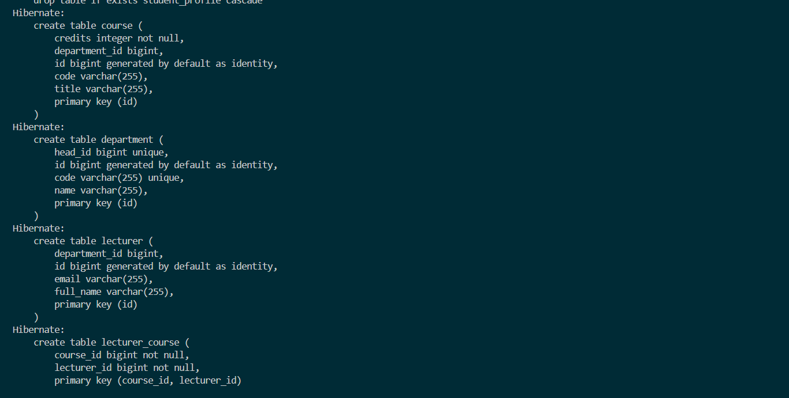
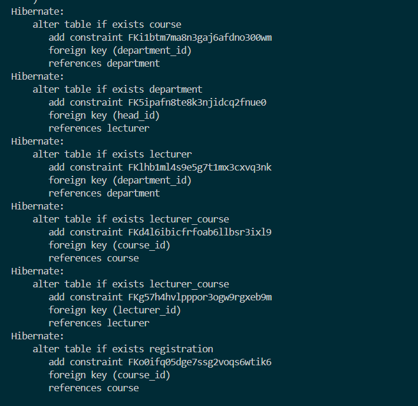

# University Course Registration and Academic Management System

**Student:** BIRORI SONIA  |  **STU ID:** 26072
**Stack:** Spring Boot, Hibernate/JPA, PostgreSQL (`university_academic_db`), Maven

## Deliverables
1. [Problem analysis and entities](docs/01-analysis.md)
2. [Entity Relationship Diagram](docs/02-erd.md)
3. [Relational schema](docs/03-schema.md)
4. Source code: `src/main/java/com/university/academic/model` and `repository`
5. Database: 7 tables generated by Hibernate (`ddl-auto=update`)
6. Screenshots below

## Screenshots
### Generated tables

### ERD from pgAdmin

### Foreign keys

### Hibernate table creation log

## How to run
1. Create the database: `CREATE DATABASE university_academic_db;`
2. Set your PostgreSQL password in `src/main/resources/application.properties`
3. Run: `mvnw spring-boot:run`