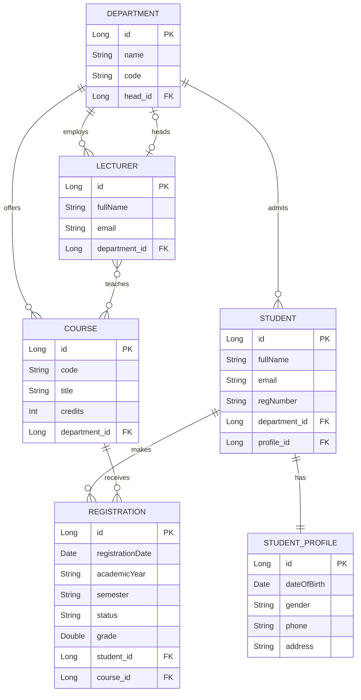

# Entity Relationship Diagram

## Notes
- Lecturer to Course is Many-to-Many, implemented with the join table `lecturer_course` (no box, because it has no entity).
- Registration is the join entity between Student and Course (it carries its own data).
- `head_id` in Department and `profile_id` in Student are UNIQUE foreign keys (one-to-one).