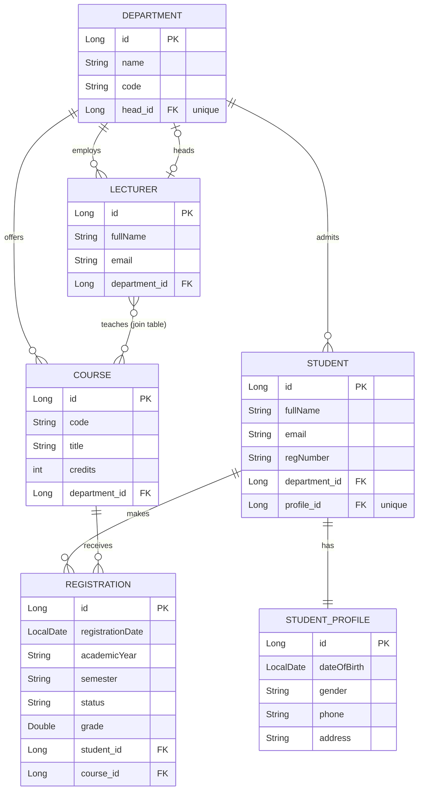

# Entity Relationship Diagram

## How to read it
- `||` means exactly one, `o{` means zero or many, `|o` means zero or one.
- Lecturer to Course is Many-to-Many and is implemented with the join table `lecturer_course`. It does not appear as a box because it has no entity.
- Registration is the join entity between Student and Course. It appears as a box because it carries its own data.